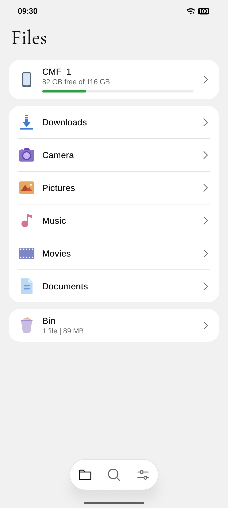
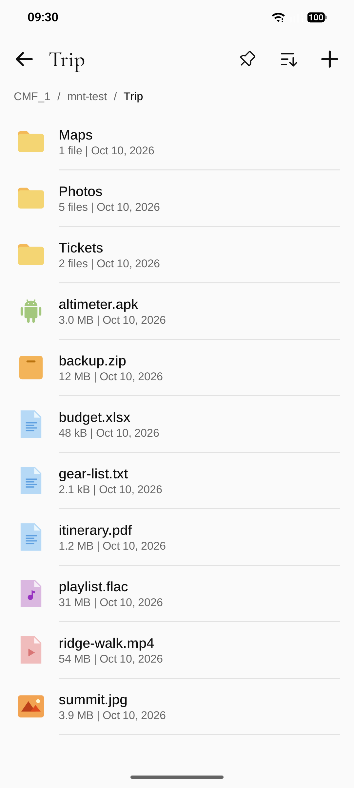
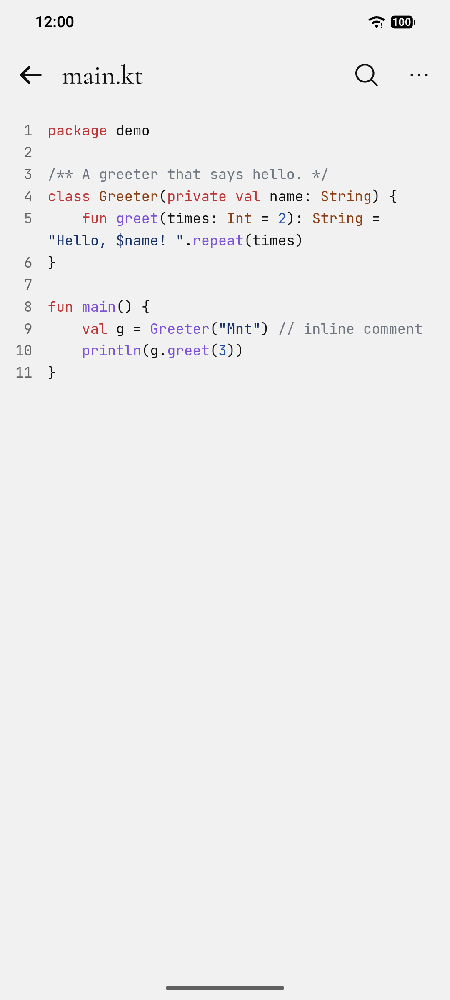
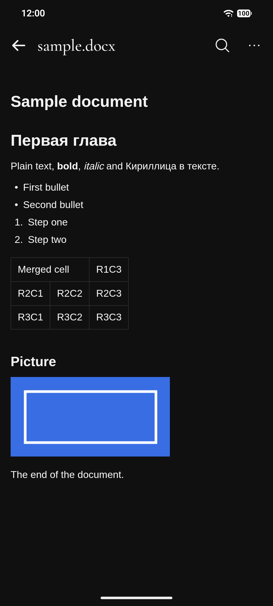

# Mnt

Android file manager for the phone's own storage, memory cards and drives
plugged into the USB port, for servers on the network — SMB, FTP, S3, NFS —
and for cameras and phones that speak MTP: browse, search, copy, move, rename
and delete, with long jobs running on in the background, open archives as
folders, look through photos — RAW and HDR ones too — and open documents,
books, tables and code right inside it. Android 16+ only; the interface
speaks ten languages.

<p>
  
  
  
  
</p>

The files on the screenshots are made up.

## Contents

- [Features](#features)
- [Stack](#stack)
- [Project layout](#project-layout)
- [Build](#build)
  - [Local build in Docker](#local-build-in-docker)
  - [Install on a phone](#install-on-a-phone)
- [Download](#download)
- [Design](#design)
- [License](#license)

## Features

- **Files** — the phone, the memory card and each drive with how full it is,
  a drive of several volumes as one device, the folders you see and pin.
- **Servers and devices** — add a server by its address and walk it like a
  folder; a camera or a phone on the USB port shows up by itself.
- **Folders** — a list sorted the way you choose, each file and folder with
  the picture VS Code gives it.
- **Viewer** — documents, spreadsheets, slides, books, scans and code open in
  the app to select, copy and search in; a Word document is laid out on its
  pages, as printed, with its headers and footers, a book on pages the size of
  the screen, and an island counts the pages and steps through them; a
  spreadsheet keeps its fonts, fills, borders and column widths, as Excel
  shows it; links open in its own browser.
- **Archives** — ZIP, 7z, RAR, TAR with gzip, bzip2, xz or zstd, ISO and more
  open as folders: open any file in them, take out the ones you pick, or hold
  an archive and unpack it whole next to itself into a folder of its name.
  Names a Windows zip wrote in its DOS code page read right. A compressed
  stream that would take long to read through, on the phone or on a
  server, asks first; reading it and the way to a file deep in one show
  how far they have got, and what an archive holds is remembered for the
  next time. An archive with a password, too many files, or one
  that would need more memory than the phone has to spare, says so and
  offers the app that can.
- **Pictures** — the photos of a folder swiped through and grown with two
  fingers, RAW and HDR ones too, the details of a shot and where it was
  taken pushed up from below, and small pictures in place of icons.
- **Select and act** — tick any number of rows, then copy, move, share,
  rename, delete or pack them into a ZIP, or read what they are and hold;
  inside an archive, extract them.
- **Bin** — what you delete on the phone is kept for 30 days and can be put
  back where it was; after that, or when you say so, it is removed
  forever. Deleting forever at once is there too. On memory cards and
  drives a delete is forever unless you turn their bin on in the settings.
- **Copy and move** — pick in one folder, paste in another, on the phone or
  on a server; a long copy goes on with the app closed and stops when told,
  and the phone answers in the hand when it is done.
- **Search** — finds files and folders by a part of their name on the phone
  and on every drive at once, and offers what you searched for before.
- **Backup and updates** — settings, pinned folders and the search history in
  one file, encrypted with a password if you like; new versions from GitHub.
- **Private by default** — no accounts or analytics; the network is used only
  for the servers you add and for the version check you turn on.

## Stack

| Area | Choice |
|---|---|
| Language / build | Kotlin 2.4, AGP 9.4 (built-in Kotlin), Gradle 9.8, JDK 25; C++ with NDK 29 and CMake 4.1 |
| SDK | `minSdk 36` (Android 16), `compileSdk`/`targetSdk 37` |
| UI | Jetpack Compose (BOM 2026.09), Material 3, Navigation 3 |
| Files | `java.io` / `java.nio` behind one `FileStore` interface, all files access |
| Storage | DataStore for settings |
| Servers | smbj for SMB, Apache Commons Net for FTP, nfs-client for NFS; S3 is spoken by the app itself |
| USB devices | the platform's `MtpDevice` |
| Network | `HttpURLConnection`, kotlinx.serialization for JSON |
| Viewer | pages of the app's own HTML in a `WebView`; its own readers for Office, OpenDocument, RTF and EPUB files and its own syntax colouring; commonmark for Markdown, androidx.pdf for PDF, DjVuLibre 3.5 for DjVu |
| Archives | libarchive 3.8 (read only) with XZ Utils 5.8, Zstandard 1.5 and bzip2 1.0, zlib of the system |
| Pictures | the platform's decoders and its region decoder, the app's own drawing of HDR gain maps; LibRaw 0.22 for RAW, libjxl 0.12 with Highway 1.4, libtiff 4.7, AndroidSVG 1.4, AndroidX ExifInterface; OpenStreetMap tiles for the map of a photo |

All versions live in [`gradle/libs.versions.toml`](gradle/libs.versions.toml).

## Project layout

```
app/src/main/kotlin/dev/glowcow/mnt/
  files/        what a file is and where it lives: paths, the store behind
                them, devices and their volumes, the order of a listing,
                search;
                copy, move, delete and packing into a zip, with the manager
                that runs one at a time and the foreground service that keeps
                it going;
                the bin and the daily job that empties it of old things;
                handing a file to another app, one on a server included
  net/          the servers the user adds and how each is spoken to — SMB,
                FTP, S3, NFS — the MTP devices on the USB port, and the
                sealed file the servers are kept in
  archive/      archives as places to walk: libarchive's reader over a file
                of the phone or of a server, what an archive holds, the
                store that reads its files
  view/         the viewer: what kind of file is shown how, the readers of
                documents, workbooks, slides, books and DjVu, the colouring of
                code and its schemes, the pages they are turned into;
                view/image: which reader a picture takes, the platform's and
                the app's own (RAW, JPEG XL, TIFF, SVG, Photoshop), what a
                photo tells of itself, the thumbnails of a folder
  maps/         OpenStreetMap's tiles, kept once downloaded
  backup/       the backup file, its password encryption, save and restore
  update/       check for a new release, download, the weekly job
  data/         settings
  ui/files/     the Files tab, a device's volumes, a folder's page and its
                sheets, the bin, the page that adds a server
  ui/search/    the Search tab
  ui/view/      the viewer's page, the PDF page and the in-app browser
  ui/photo/     the pictures' page: swiping, growing, the HDR drawing, details
  ui/settings/  the Settings tab and its pages
  ui/           theme + icons, shared components (tab page and detail page
                with the frosted bars, grouped rows and sheets, the row of a
                file, the all files access gate), navigation root
app/src/main/cpp/  DjVuLibre, libarchive (with liblzma, zstd and bzip2), and
                LibRaw, libjxl (with Highway) and libtiff, each with its JNI
                bridge
app/src/main/assets/material-icons.json  the shapes of the file icons
app/src/test/   unit tests of the plain JVM code in files, archive, backup,
                update and view, the readers checked on sample documents
```

## Build

The host needs only Docker: JDK, Android SDK, NDK, CMake and the Gradle
distribution live in the `glowcow/android-ndk` image on Docker Hub (tag =
`<build-tools>-gradle<gradle>-ndk<ndk>`), so a build downloads only the app's
own dependencies. Keep the tag in step with `buildToolsVersion`, `ndkVersion`
and the Gradle wrapper.
The build runs as `linux/amd64` (Google ships `aapt2` for x86-64 Linux only).
On Apple Silicon turn on *Use Rosetta for x86_64/amd64 emulation* in Docker
Desktop and give the VM ~12 GB of memory.

### Local build in Docker

Run Gradle in the toolchain image with the sources mounted and a persistent
dependency cache:

```sh
IMAGE=glowcow/android-ndk:37.0.0-gradle9.8.0-ndk29.0.14206865
RUN="docker run --rm --platform linux/amd64 -v $PWD:/src -w /src -v mnt-gradle:/root/.gradle/caches -v mnt-keys:/root/.android $IMAGE"

# debug APKs + unit tests
$RUN ./gradlew testDebugUnitTest assembleDebug

# lint + release APKs, unsigned; -PappVersion sets the version
$RUN ./gradlew -PappVersion=0.1.0 lintRelease assembleRelease
```

The APKs land in `app/build/outputs/apk/<type>/`, one per ABI:
`app-arm64-v8a-<type>.apk` for phones and `app-x86_64-<type>.apk` for the
emulator. The `mnt-keys` volume keeps the debug keystore, so a rebuilt debug
APK installs over the previous one.

### Install on a phone

Enable *Developer options → Wireless debugging* on the phone, then use `adb`
from the same image (the volume keeps the adb pairing keys):

```sh
docker run --rm -it --platform linux/amd64 -v mnt-adb:/root/.android -v "$PWD/app/build/outputs/apk":/apk \
  glowcow/android-sdk:37.0.0-gradle9.8.0 sh -c 'adb pair <ip>:<pair-port> && adb connect <ip>:<port> && adb install -r /apk/debug/app-arm64-v8a-debug.apk'
```

Or copy the APK to the phone and open it.

## Download

Signed APKs are attached to every
[release](https://github.com/glowcow/mnt/releases). Phones take
`mnt-<version>-arm64-v8a-release.apk`; the `x86_64` one is for the emulator.
There is no store listing: allow your browser or file manager to install
apps, then open the file. Later versions can be installed from inside the
app: *Settings → Version*.

Releases are signed with the certificate `CN=Anton Sediuk, O=glowcow`,
SHA-256
`7E:63:EC:86:6B:13:A8:23:B4:1B:4F:07:05:75:50:13:8F:B6:65:C3:50:B8:0D:41:CF:CF:B2:19:CB:98:C5:67`.
Check a downloaded file with `apksigner verify --print-certs <file>.apk`.

## Design

The look is shared with [stackd](https://github.com/glowcow/stackd) and
[Altair GNSS](https://github.com/glowcow/altair-gnss). The default *classic*
scheme is neutral grey — light `#FAFAFA` / dark `#161616` backgrounds, accent
`#1F6FEB`; the *warm* scheme has `#FAF9F5` / `#1A1A18` and accent `#D97757`.
UI font: Arimo, with page titles in Cormorant Garamond and code in JetBrains
Mono. Files, folders and places are drawn with Material Icon Theme, the icons
of VS Code's explorer, in their own colours; the controls with Phosphor. Code
takes one of seven schemes — Light, Dark, Solarized Light and Dark, Monokai,
Dracula or none — one for the light theme and one for the dark. The header is frosted glass and the bar at the bottom an
island of it: the list scrolls on under them, blurred — the viewer's pages
too, which draw that glass in their own HTML. The accent and the
red of deleting forever are drawn in Display P3 where the screen shows it.
Pictures are shown on black in either theme.
The launcher icon and the splash screen
use the brand palette — paper `#F2F0EA`, ink `#14161A`, amber `#F5A524`; the
icon is ink in either theme, the splash turns dark with the system. Word
documents set in Times are shown in Tinos, which is as wide, so their lines
and pages break where Word breaks them.

## License

[GNU General Public License v3.0 or later](LICENSE) © Anton Sediuk. A
modified version you distribute has to stay open under the same licence.

Arimo, Cormorant Garamond, JetBrains Mono and Tinos are bundled under the SIL
Open Font License 1.1 — see [`licenses/Arimo-OFL.txt`](licenses/Arimo-OFL.txt),
[`licenses/CormorantGaramond-OFL.txt`](licenses/CormorantGaramond-OFL.txt),
[`licenses/JetBrainsMono-OFL.txt`](licenses/JetBrainsMono-OFL.txt) and
[`licenses/Tinos-OFL.txt`](licenses/Tinos-OFL.txt). The icons are
[Material Icon Theme](https://github.com/material-extensions/vscode-material-icon-theme)
and [Phosphor Icons](https://phosphoricons.com), both MIT — see
[`licenses/MaterialIconTheme-MIT.txt`](licenses/MaterialIconTheme-MIT.txt)
and [`licenses/Phosphor-MIT.txt`](licenses/Phosphor-MIT.txt).

[DjVuLibre](https://djvu.sourceforge.net) 3.5.30 is built into the app from
its source in `app/src/main/cpp/djvulibre`, under the GNU General Public
License v2.0 or later — see
[`licenses/DjVuLibre-GPL-2.0.txt`](licenses/DjVuLibre-GPL-2.0.txt).

The reading side of [libarchive](https://libarchive.org) 3.8.10 is built in
from `app/src/main/cpp/libarchive`, with the decoders of
[XZ Utils](https://tukaani.org/xz/) 5.8.4, [Zstandard](https://facebook.github.io/zstd/)
1.5.7 and [bzip2](https://sourceware.org/bzip2/) 1.0.8 beside it — under the
BSD 2-Clause, 0BSD, BSD 3-Clause and bzip2 licences, see
[`licenses/libarchive-BSD-2-Clause.txt`](licenses/libarchive-BSD-2-Clause.txt),
[`licenses/XZ-Utils-0BSD.txt`](licenses/XZ-Utils-0BSD.txt),
[`licenses/Zstandard-BSD-3-Clause.txt`](licenses/Zstandard-BSD-3-Clause.txt) and
[`licenses/bzip2-1.0.8.txt`](licenses/bzip2-1.0.8.txt). Three files carry a
change of the app's, marked `mnt:` — a decoder's dictionary is held to the
memory the phone can spare.

[LibRaw](https://www.libraw.org) 0.22.2 is built in from
`app/src/main/cpp/libraw` under the GNU Lesser General Public License 2.1
(LibRaw is also offered under the CDDL 1.0) — see
[`licenses/LibRaw-LGPL-2.1.txt`](licenses/LibRaw-LGPL-2.1.txt).
[libjxl](https://github.com/libjxl/libjxl) 0.12.0 (BSD 3-Clause with its
patent grant), [Highway](https://github.com/google/highway) 1.4.0 (Apache
License 2.0 or BSD 3-Clause) and [libtiff](https://libtiff.gitlab.io/libtiff/)
4.7.2 (its own BSD-style licence) are built in from their sources beside it —
see [`licenses/libjxl-BSD-3-Clause.txt`](licenses/libjxl-BSD-3-Clause.txt),
[`licenses/Highway-Apache-2.0-or-BSD-3-Clause.txt`](licenses/Highway-Apache-2.0-or-BSD-3-Clause.txt)
and [`licenses/libtiff.txt`](licenses/libtiff.txt). The map of where a photo
was taken, when it is turned on, is © OpenStreetMap contributors, under the
Open Database License.

The app links [smbj](https://github.com/hierynomus/smbj),
[Apache Commons Net](https://commons.apache.org/proper/commons-net/) and
[nfs-client](https://github.com/EMCECS/nfs-client-java) with what they
bring along, [androidx.pdf](https://developer.android.com/jetpack/androidx/releases/pdf),
AndroidX ExifInterface and [AndroidSVG](https://bigbadaboom.github.io/androidsvg/),
all under the Apache License 2.0;
[commonmark-java](https://github.com/commonmark/commonmark-java) under the
BSD 2-Clause licence; and Bouncy Castle under its MIT-style licence.
