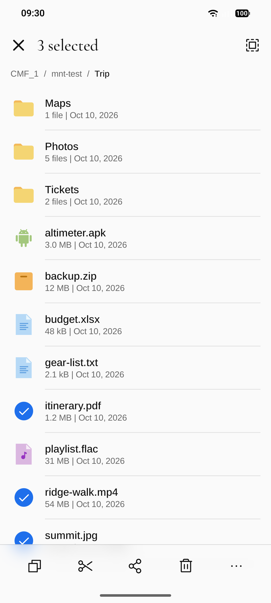

# Mnt

Android file manager for the phone's own storage, memory cards and drives
plugged into the USB port, for servers on the network — SMB, FTP, S3, NFS —
and for cameras and phones that speak MTP: browse, search, copy, move, rename
and delete, with long jobs running on in the background. Android 16+ only;
the interface speaks ten languages. A built-in viewer is planned and not
there yet.

<p>
  
  
  
  
</p>

The files on the screenshots are made up.

## Contents

- [Features](#features)
- [Stack](#stack)
- [Project layout](#project-layout)
- [Build](#build)
  - [Local build in Docker](#local-build-in-docker)
  - [Install on a phone](#install-on-a-phone)
- [Download](#download)
- [Design](#design)
- [License](#license)

## Features

- **Files** — the phone, the memory card and each drive with how full it is,
  a drive of several volumes as one device, the folders you see and pin.
- **Servers and devices** — add a server by its address and walk it like a
  folder; a camera or a phone on the USB port shows up by itself.
- **Folders** — a list sorted the way you choose, each kind of file with a
  picture of its own; a tap hands a file to the app that shows its type.
- **Select and act** — tick any number of rows, then copy, move, share,
  rename, delete or pack them into a ZIP, or read what they are and hold.
- **Bin** — what you delete on the phone is kept for 30 days and can be put
  back where it was; after that, or when you say so, it is removed
  forever. Deleting forever at once is there too. On memory cards and
  drives a delete is forever unless you turn their bin on in the settings.
- **Copy and move** — pick in one folder, paste in another, on the phone or
  on a server; a taken name can be replaced, kept beside the old or skipped.
- **In the background** — a long copy goes on with the app closed, shows how
  far and how fast it goes, and stops when told to.
- **Search** — finds files and folders by a part of their name on the phone
  and on every drive at once, and offers what you searched for before.
- **Backup and updates** — settings, pinned folders and the search history in
  one file, encrypted with a password if you like; new versions from GitHub.
- **Private by default** — no accounts or analytics; the network is used only
  for the servers you add and for the version check you turn on.

## Stack

| Area | Choice |
|---|---|
| Language / build | Kotlin 2.4, AGP 9.4 (built-in Kotlin), Gradle 9.8, JDK 25 |
| SDK | `minSdk 36` (Android 16), `compileSdk`/`targetSdk 37` |
| UI | Jetpack Compose (BOM 2026.09), Material 3, Navigation 3 |
| Files | `java.io` / `java.nio` behind one `FileStore` interface, all files access |
| Storage | DataStore for settings |
| Servers | smbj for SMB, Apache Commons Net for FTP, nfs-client for NFS; S3 is spoken by the app itself |
| USB devices | the platform's `MtpDevice` |
| Network | `HttpURLConnection`, kotlinx.serialization for JSON |

All versions live in [`gradle/libs.versions.toml`](gradle/libs.versions.toml).

## Project layout

```
app/src/main/kotlin/dev/glowcow/mnt/
  files/        what a file is and where it lives: paths, the store behind
                them, devices and their volumes, the order of a listing,
                search;
                copy, move, delete and packing into a zip, with the manager
                that runs one at a time and the foreground service that keeps
                it going;
                the bin and the daily job that empties it of old things;
                handing a file to another app, one on a server included
  net/          the servers the user adds and how each is spoken to — SMB,
                FTP, S3, NFS — the MTP devices on the USB port, and the
                sealed file the servers are kept in
  backup/       the backup file, its password encryption, save and restore
  update/       check for a new release, download, the weekly job
  data/         settings
  ui/files/     the Files tab, a device's volumes, a folder's page and its
                sheets, the bin, the page that adds a server
  ui/search/    the Search tab
  ui/settings/  the Settings tab
  ui/           theme + icons, shared components (tab page and detail page
                with the frosted bars, grouped rows and sheets, the row of a
                file, the all files access gate), navigation root
app/src/test/   unit tests of the plain JVM code in files, backup and update
```

## Build

The host needs only Docker: JDK, Android SDK and the Gradle distribution live
in the `glowcow/android-sdk` image on Docker Hub (tag =
`<build-tools>-gradle<gradle>`), so a build downloads only the app's own
dependencies. Keep the tag in step with `buildToolsVersion` and the Gradle
wrapper.
The build runs as `linux/amd64` (Google ships `aapt2` for x86-64 Linux only).
On Apple Silicon turn on *Use Rosetta for x86_64/amd64 emulation* in Docker
Desktop and give the VM ~12 GB of memory.

### Local build in Docker

Run Gradle in the toolchain image with the sources mounted and a persistent
dependency cache:

```sh
IMAGE=glowcow/android-sdk:37.0.0-gradle9.8.0
RUN="docker run --rm --platform linux/amd64 -v $PWD:/src -w /src -v mnt-gradle:/root/.gradle/caches -v mnt-keys:/root/.android $IMAGE"

# debug APKs + unit tests
$RUN ./gradlew testDebugUnitTest assembleDebug

# lint + release APKs, unsigned; -PappVersion sets the version
$RUN ./gradlew -PappVersion=0.1.0 lintRelease assembleRelease
```

The APKs land in `app/build/outputs/apk/<type>/`, one per ABI:
`app-arm64-v8a-<type>.apk` for phones and `app-x86_64-<type>.apk` for the
emulator. The `mnt-keys` volume keeps the debug keystore, so a rebuilt debug
APK installs over the previous one.

### Install on a phone

Enable *Developer options → Wireless debugging* on the phone, then use `adb`
from the same image (the volume keeps the adb pairing keys):

```sh
docker run --rm -it --platform linux/amd64 -v mnt-adb:/root/.android -v "$PWD/app/build/outputs/apk":/apk \
  glowcow/android-sdk:37.0.0-gradle9.8.0 sh -c 'adb pair <ip>:<pair-port> && adb connect <ip>:<port> && adb install -r /apk/debug/app-arm64-v8a-debug.apk'
```

Or copy the APK to the phone and open it.

## Download

Signed APKs are attached to every
[release](https://github.com/glowcow/mnt/releases). Phones take
`mnt-<version>-arm64-v8a-release.apk`; the `x86_64` one is for the emulator.
There is no store listing: allow your browser or file manager to install
apps, then open the file. Later versions can be installed from inside the
app: *Settings → Version*.

Releases are signed with the certificate `CN=Anton Sediuk, O=glowcow`,
SHA-256
`7E:63:EC:86:6B:13:A8:23:B4:1B:4F:07:05:75:50:13:8F:B6:65:C3:50:B8:0D:41:CF:CF:B2:19:CB:98:C5:67`.
Check a downloaded file with `apksigner verify --print-certs <file>.apk`.

## Design

The look is shared with [stackd](https://github.com/glowcow/stackd) and
[Altair GNSS](https://github.com/glowcow/altair-gnss). The default *classic*
scheme is neutral grey — light `#FAFAFA` / dark `#161616` backgrounds, accent
`#1F6FEB`; the *warm* scheme has `#FAF9F5` / `#1A1A18` and accent `#D97757`.
UI font: Arimo, with page titles in Cormorant Garamond. Files, folders and
places are drawn with Flat Color Icons in their own colours, the controls
with Phosphor. The header is frosted glass and the bar at the bottom an
island of it: the list scrolls on under them, blurred. The accent and the
red of deleting forever are drawn in Display P3 where the screen shows it.
The launcher icon and the splash screen
use the brand palette — paper `#F2F0EA`, ink `#14161A`, amber `#F5A524` — and
turn dark with the system.

## License

[GNU General Public License v3.0 or later](LICENSE) © Anton Sediuk. A
modified version you distribute has to stay open under the same licence.

Arimo and Cormorant Garamond are bundled under the SIL Open Font License
1.1 — see [`licenses/Arimo-OFL.txt`](licenses/Arimo-OFL.txt) and
[`licenses/CormorantGaramond-OFL.txt`](licenses/CormorantGaramond-OFL.txt). The icons are
[Flat Color Icons](https://github.com/icons8/flat-color-icons) by Icons8
and [Phosphor Icons](https://phosphoricons.com), both MIT — see
[`licenses/FlatColorIcons-LICENSE.txt`](licenses/FlatColorIcons-LICENSE.txt)
and [`licenses/Phosphor-MIT.txt`](licenses/Phosphor-MIT.txt).

The app links [smbj](https://github.com/hierynomus/smbj),
[Apache Commons Net](https://commons.apache.org/proper/commons-net/) and
[nfs-client](https://github.com/EMCECS/nfs-client-java) with what they
bring along, all under the Apache License 2.0, and Bouncy Castle under its
MIT-style licence.
